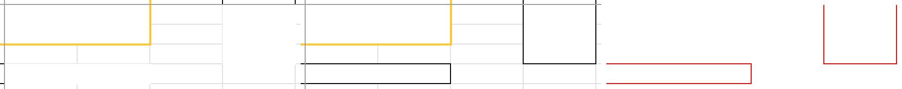
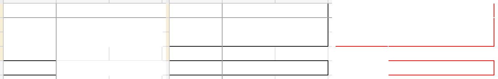
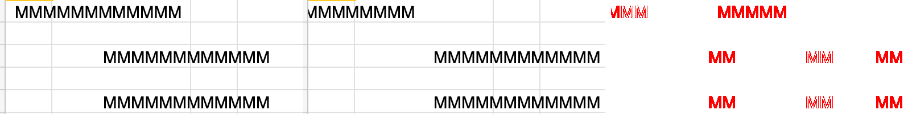
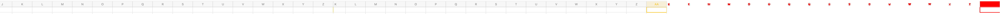
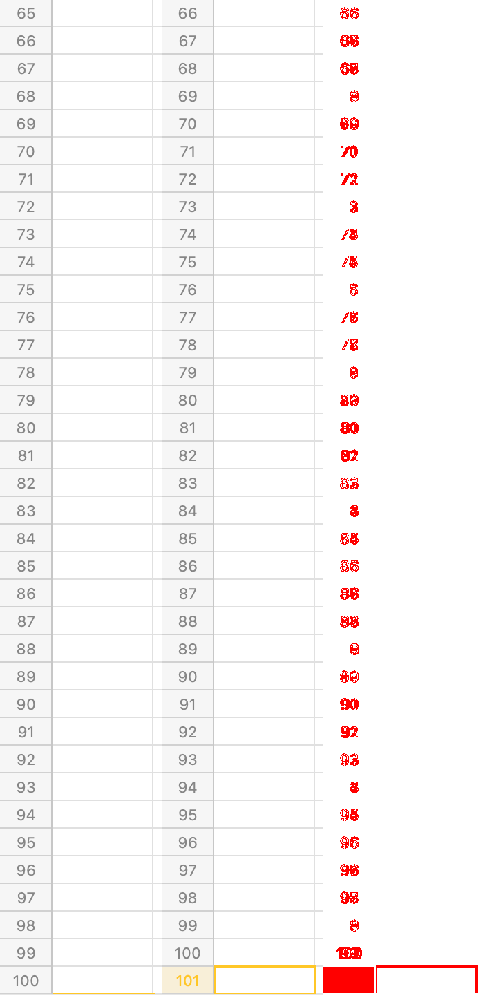
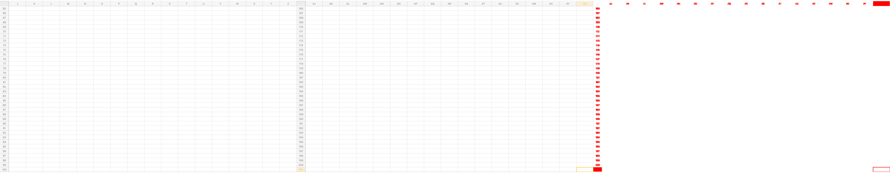

# 界面与编辑回归（2026-11-16）

范围：只处理只读排查清单第 1、2、3、5、6、9、10、11、12、13 条。基线是 `origin/main` 的
`f9405b407240daa10e41f00c71446389df908006`。期间 main 合入的 `c9861ff` 仅改文档，本分支已重放到该提交并保留其方案；上述运行基线的生产代码与它相同。
没有读取 SampleData，没有改恢复、备份三个实现。

## 复现和修改

自检都在 `Sources/SkySheetChecks/UI/`，由 `scripts/check-ui.sh` 链接已有 debug App 对象执行。
这样能直接调真实会话、画布和渲染器，不必为测试改生产模块的边界。测试不链接 App 的 main，不启动恢复、文档或 MCP，
不读写系统剪贴板；窗口用 OffscreenWindow，从不上屏。颜色的两个崩溃入口分进程跑，避免一个崩溃遮住另一个。
[改前完整失败日志](ui-hunt-2026-11-16/reproduce.txt)（含两次独立 trap）。
补查的选中表头先失败日志见 [4.20:1 复现](ui-hunt-2026-11-16/reproduce-selected-header.txt)。

| 条目 | 自检组名 | 改前实际结果 | 修法与补充覆盖 |
| --- | --- | --- | --- |
| 1 | `ui-1: internal clipboard preserves CellValue` | `123456789012345.6` 变成 `123456789012346`；`0.5` 时间变文字；`#N/A` 变文字 | 内部格式 v2 直接携带 CellValue、公式和源日期系统。Decimal 编为完整十进制文字，不经过显示格式或 Double；补测 38 位数、布尔、空值、形似公式的文字、未知错误、循环错误、单格填满和公式引用平移、未知公式缓存 |
| 2 | `ui-2: 1904 formula bar and clipboard` | 公式栏显示 2023/3/15，粘贴后 45000 变 43538 | 公式栏显式传 workbook.dateSystem；内部复制不解析显示日期，45000 原样保留；断言剪贴板含 1904 系统 |
| 3 | `ui-3: commit editing before sheet operations` | Duplicate Other 后 Main 仍为空，文字写到副本；Delete Main 后文字写到 Other | 复制和删除页签先 commitEditing；普通 showSheet 已经正确，保留原实现并回归；补测复制正在编辑的表、复制其他表、复制格子前提交 |
| 5 | `ui-5: reject sparse rectangle before allocation` | 原复制范围计算接受 A1:XFD1048576，面积 17,179,869,184；接受 110 万格 | 先把原范围计算提成不分配的共用预检，确认接受超限，再加 100 万格面积限制。复现只调预检，未运行巨大 map；两份数据展开前共用该预检，剪切失败不清源格；边界 100 万接受、110 万拒绝 |
| 6 | `ui-6a: invalid theme and palette indices`；`ui-6b: overflowing format color` | 最小 xlsx 的 theme=-1 下标越界崩溃；Color Int.max 加 7 溢出崩溃 | 主题先拒绝负数；格式色先限定 1…56 再加偏移。补测 Int.min、Int.max、不可装进 Int 的 XML 数字、调色板越界与合法端点 |
| 9 | `ui-9: chrome contrast in Aqua and Dark Aqua` | Dark Aqua 尺寸提示不够 4.5:1；表头文字对比约 1.04:1 | 界面灰底按外观与动态文字成对；浅色外观沿用原灰度，格子白底和文件色不变。分别渲染两种外观，核对表头和提示；修复后 Dark Aqua 实测表头 5.43:1、尺寸提示 9.49:1（提示计入透明度及白色格子底），选中表头从 4.20:1 改为 6.61:1 |
| 10 | `ui-10: localized size defaults round trip` | 德语和法语的默认 8,43 都解析为 nil | 同一个按当前地区配置的 NumberFormatter 同时显示和解析；测试 en_US、de_DE、fr_FR 的宽高边界和默认值 |
| 11 | `ui-11: visible merged borders without anchor in pane` | 横向、纵向和双向跨窗格的右边界均无黑色像素 | 每块窗格画与自己相交的合并外框；保留按左上角位置的覆盖顺序，左上角不必在该窗格可见范围内 |
| 12 | `ui-12: centered overflow remains anchored to source cell` | 首列、左边阻挡、邻列宽不等三个布局与原格中心锚点的独立参考光栅不符；对称空列布局通过 | 只扩大裁剪范围，居中文字仍按原格 midX 定位；四种布局逐像素核对红字 |
| 13 | `ui-13: active cursor outside used extent` | AA1、A101、AZ201 越过画布边界，布局后仍不可见 | 越界时只扩几何计数，先布局再滚动，不重新数格子、排行列或重建显示缓存；初始化和画布复用也保留活动格范围 |

## 同类写法

- 查了 Colors.swift 全部数组访问和偏移：主题的前四项交换、主题数组、旧调色板、格式颜色；前两处缺陷已修，主题和调色板的最终访问原本已有 `indices.contains`。
- 查了 StyleResolver 的字体、填充、边框、样式编号，StyleTable 的格式编号访问，原本都有边界或默认值保护，未改。
- 查了 sheetIndex 的切换入口：showSheet 已提交；duplicateSheet、deleteSheet 补上。undo 会取消待提交编辑，未改。
- 查了两份复制数据和剪切路径，统一先预检；系统文字仍用原显示格式和 TSV 引号规则。
- 查了四块 PaneView 共用的合并外框路径、文字三种对齐、画布重建与缓存复用；修改共用内核，不为各窗格复制实现。
- 查了表头、左上角和尺寸提示的前景/背景配对；单元格和冻结线保留原文件色与白底。

## 可见行为

- 内部复制保持数值、类型、源日期系统元数据和公式；字面值按原序列号粘贴，不改目标工作簿的日期系统。系统文字仍供其他 App 使用。
- 编辑中的内容在复制、删除、切换 sheet 前提交到原 sheet。
- 复制超过 1,000,000 格时拒绝，在分配矩形数组、生成 TSV、修改剪贴板之前检查。选择这个上限是为了给两份密集数据的内存和主线程工作量一个明确边界。
  英文提示为：`The selection is too large to copy. Select no more than 1,000,000 cells and try again.`
- 非法颜色编号回到默认色；深色界面更清楚；德法地区可以直接确认宽高默认值。
- 跨窗格的合并外框补齐；居中文字溢出保留原格中心；活动格移出用到范围时仍能看见。

## 验证记录

`nice -n 10 scripts/check-all.sh` 全过：原有 9,480 条、新增 UI 105 条（[最终完整日志](ui-hunt-2026-11-16/check-all.txt)）。

七份表分别完整跑 `--benchmark-only verify`（100% / 137%，含新增的跨画布边界、移动、返回）：

| 表 | 视图逐像素比较次数 | 不一致 |
| --- | ---: | ---: |
| loan.xlsx | 1,004 | 0 |
| synthetic:data（完整 10 万行） | 1,028 | 0 |
| synthetic:formulas | 584 | 0 |
| synthetic:styles | 1,920 | 0 |
| merge.xlsx | 1,088 | 0 |
| center.xlsx | 576 | 0 |
| extent.xlsx | 576 | 0 |
| 合计 | 6,776 | 0 |

### 截图逐像素比较

13 对 2560×1600 截图，窗口从不上屏，全部输出路径都是新文件。基线恢复了 origin/main 的全部生产逻辑，
仅附加固定截图外观和 arrows 测速两个测试选项（[完整仪器补丁](ui-hunt-2026-11-16/origin-instrumentation.patch)）。
显式 `--appearance aqua` 在进程内固定外观，不改系统设置；这样深色模式第 9 条的修复不会混进 11–13 的绘图对比。
最终几何与外观缓存处理前后，13 张也全部相同（[缓存处理像素核对](ui-hunt-2026-11-16/final-cache-pixels.json)）。
移除临时测量插桩后，最终源码重建的 13 张截图也与已读图版本各 0 像素差异（[最终源码像素核对](ui-hunt-2026-11-16/final-source-pixels.json)）。
PNG 统一解码为 sRGB 后逐像素比，不比较压缩字节；[完整差异计数、边界和行带](ui-hunt-2026-11-16/pixels.json)。

| 截图 | 改变像素 | 已读图核对的变化 |
| --- | ---: | --- |
| loan-A1、loan-K60、loan-AB150、loan-range（A1:D8，137%） | 各 0 | 全部相同 |
| data-K60、formulas-K60 | 各 0 | 全部相同 |
| styles-K60 | 288 | 第 11 条：B28:B30 的锚点滚走后，补齐底边（2 像素高、144 像素宽） |
| merge-top | 2,012 | 第 11 条：冻结行列分界以外的 E1:E4 右/底边、A5:C5 横向外框补齐；被选区盖住的 A1:C3 边界保持选区色 |
| merge-scroll | 2,348 | 第 11 条：锚点不在主窗格里的 A1:C3、A5:C5 的可见右/底边补齐 |
| center | 5,807 | 第 12 条：A2 文本以 A2 中心为准，左半截裁在表外；C4/C6 按 C 格中心定位，不再随不等宽邻列偏移 |
| extent-AA1 | 9,833 | 第 13 条：水平多滚一列，AA 列标题与活动格完整进入右边界，原版最多显示到 Z |
| extent-A101 | 12,373 | 第 13 条：垂直多滚一行，底部从 100 变为选中的 101，活动格完整可见 |
| extent-AZ201 | 29,500 | 第 13 条：两轴一起扩展，标题滚到 AJ–AZ、行号 166–201，右下活动格出现 |

7 张差异图全部用图像读取工具查看过，未发现 11、12、13 以外的变化。每图三栏依次是原版、修复后、红色差异像素，
保留原像素裁切，不缩放或插值。

合并的小例子：

样式表唯一变化：

居中文字：

活动格越界：

深色表头单独补图（第 9 条，不计入上述只允许 11–13 改变的 Aqua 对比），左原版、中修复后、右差异。
普通标签从接近白字白底变为浅字深底，B 列选中文字也与强调色底配对；截图只裁取表头，没有缩放，已读图核对。

复跑截图可用 `scripts/capture-ui.sh APP INPUTS NEW_OUTPUT`；INPUTS 的三张大表用 SyntheticWorkbook 的完整默认规模生成，
另外三份小例子从 `Fixtures/UIHunt/` 复制进去。像素比较工具是 `scripts/compare-ui.swift`，只依赖系统 AppKit / ImageIO。

### 性能

只量方向键和滚动。整段先后测量即使延长至 200 帧，仍出现较大的跨轮负载摆动，因此这些诊断数字不作为加速或退步结论。
最终采用 `scripts/compare-navigation.py` 按帧交替：一版到达管道等待后另一版才执行，载入也不并行；三轮交替启动顺序、每帧交替先后顺序。
工具先预热 20 帧，两版均载入后再丢弃前 20 对样本，随后每动作采 200 对。握手、重置和输出都在主线程 CPU 计时之外；同一时刻只放行一方。
同版本 A/A 控制（公开 loan）中，纵向方向键 5.157/5.124 ms、横向 5.878/5.786 ms；[A/A 统计](ui-hunt-2026-11-16/performance/aa/1-loan-arrows.summary.json) 与最终每轮统计输出一并留存。

测量插桩仅在临时构建里，未进入正常 App：原版先用 [共用导航仪器](ui-hunt-2026-11-16/performance-instrumentation.patch)，
两版再用 [逐帧握手补丁](ui-hunt-2026-11-16/performance-stepper.patch)。
复跑命令：`nice -n 10 python3 scripts/compare-navigation.py BEFORE_EXE AFTER_EXE INPUTS NEW_OUTPUT --frames 200 --rounds 3`。
控制器要求启动即收到握手；缺失插桩或两个版本的动作/帧序列不一致会失败，避免拿空跑的结果作结论。
统计优先看同一帧的修复版减原版差值，再汇总三轮；单独两列中位数会受双峰分布和机器负载影响。
本机 16 GB，另一个程序在管道上阻塞，不同时跑两个载入/绘图负载。

三轮每轮 200 对、4 张表、5 个动作，共 12,000 对样本。下表前两列是三轮各自中位数的中位数；配对差是每帧“修复减原版”后再取三轮中位，正数为更慢。

| 表 | 动作 | 原版中位 ms | 修复中位 ms | 配对差中位 ms | 三轮配对差 ms |
| --- | --- | ---: | ---: | ---: | --- |
| loan | 方向键纵向 | 4.943 | 5.091 | +0.066 | +0.044 / +0.066 / +0.113 |
| loan | 方向键横向 | 5.818 | 5.867 | -0.049 | -0.016 / -0.116 / -0.049 |
| loan | 向下滚动 | 2.854 | 3.124 | +0.021 | -0.074 / +0.021 / +0.042 |
| loan | 向上滚动 | 3.846 | 3.816 | +0.033 | -0.139 / +0.033 / +0.117 |
| loan | 横向滚动 | 2.596 | 2.626 | +0.019 | +0.028 / +0.019 / -0.015 |
| data | 方向键纵向 | 4.586 | 4.570 | +0.065 | +0.065 / +0.076 / -0.026 |
| data | 方向键横向 | 3.814 | 3.777 | +0.011 | -0.076 / +0.011 / +0.036 |
| data | 向下滚动 | 3.733 | 3.888 | +0.016 | +0.051 / -0.000 / +0.016 |
| data | 向上滚动 | 3.829 | 3.970 | -0.004 | -0.009 / -0.004 / +0.080 |
| data | 横向滚动 | 2.542 | 2.522 | -0.006 | -0.027 / -0.006 / -0.000 |
| formulas | 方向键纵向 | 3.379 | 3.352 | -0.034 | -0.036 / -0.034 / +0.036 |
| formulas | 方向键横向 | 3.458 | 3.495 | +0.035 | +0.004 / +0.046 / +0.035 |
| formulas | 向下滚动 | 2.286 | 2.338 | +0.025 | +0.025 / +0.029 / -0.027 |
| formulas | 向上滚动 | 2.705 | 2.970 | +0.013 | +0.013 / +0.013 / +0.040 |
| formulas | 横向滚动 | 2.097 | 2.184 | -0.008 | -0.013 / +0.051 / -0.008 |
| styles | 方向键纵向 | 5.717 | 5.908 | +0.016 | +0.073 / +0.016 / -0.004 |
| styles | 方向键横向 | 4.952 | 5.301 | +0.009 | +0.000 / +0.009 / +0.069 |
| styles | 向下滚动 | 4.386 | 4.493 | +0.046 | +0.046 / -0.017 / +0.046 |
| styles | 向上滚动 | 4.543 | 4.582 | +0.099 | +0.099 / -0.009 / +0.121 |
| styles | 横向滚动 | 3.504 | 3.507 | +0.053 | +0.135 / +0.050 / +0.053 |

20 个动作的三轮配对差中位在 -0.049～+0.099 ms，同版本 A/A 五个动作的配对差中位在 -0.019～+0.113 ms；A/A 配对差 p95 约 0.98～1.24 ms。此次没有测出超出同版本对照波动的稳定退步，也不能把这些小差值当作加速。原版和修复版单独的中位数有更大差异，完整列出，避免用两列相减代替配对结果。
[三轮全部 24 份统计](ui-hunt-2026-11-16/performance/ab/) 和 [同版本对照](ui-hunt-2026-11-16/performance/aa/) 随报告保留；逐帧原始样本在本机 `perf-interleaved/` 子目录。

### 未做和环境限制

没有做真实键鼠、真实剪贴板、弹出对话框或让窗口上屏的手工验证；按任务要求，用真实会话、相同解析器和后台光栅断言覆盖。
没有改恢复副本和备份目录名（第 4、7、8 条）、原始 sheet 的 AI 权限或保存六道保险。没有合并、打包、升版本、打 tag 或发布。
首次沙盒内构建被 Swift/Clang 缓存权限阻止、AppKit 服务也受限；后续按单条命令提权完成，未绕过限制。

本机完整截图、失败日志、verify 日志、逐帧原始样本和每轮性能 JSON 在新目录 `/private/tmp/skysheet-ui-20261116/`。原版程序是 `origin-main-SkySheet`，
用于正式浅色截图的严格仪器基线是 `origin-instrumented-SkySheet`，修复截图程序是 `fixed-reviewed-SkySheet`（最终源码无插桩重建另存为 `final-SkySheet`）。
最终按帧测量程序为 `before-stepper-SkySheet` / `after-stepper-SkySheet`；前者是原版加共用导航仪器，后者是修复版加同一握手插桩，正常 App 源码已移除握手插桩。
